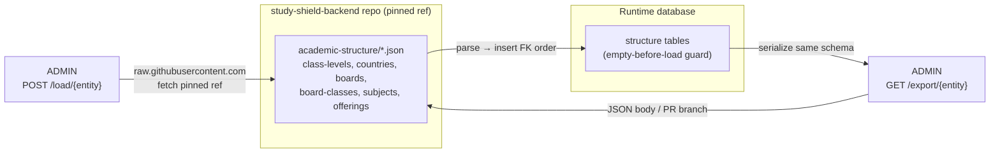
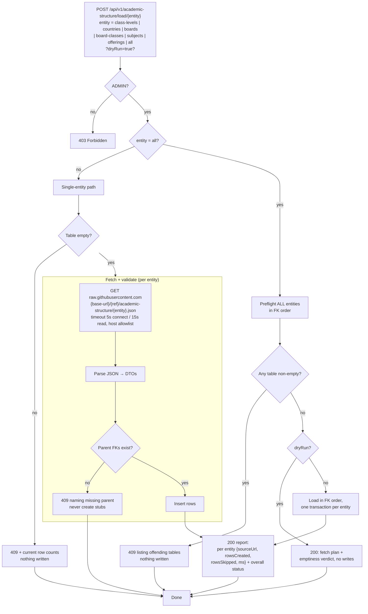
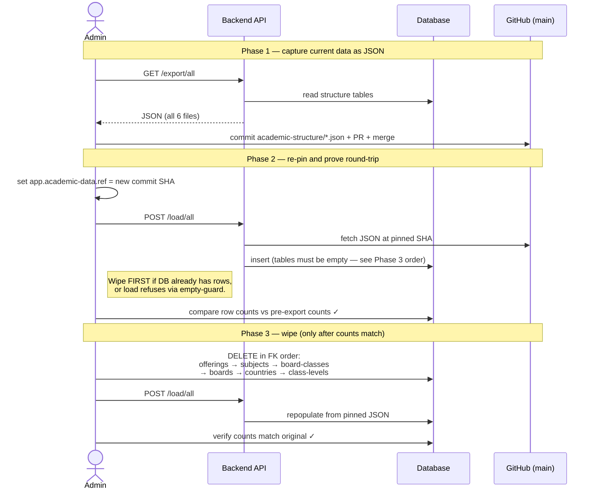
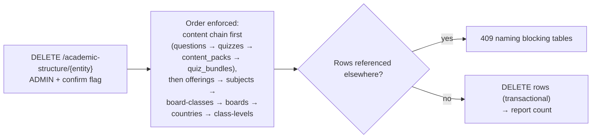
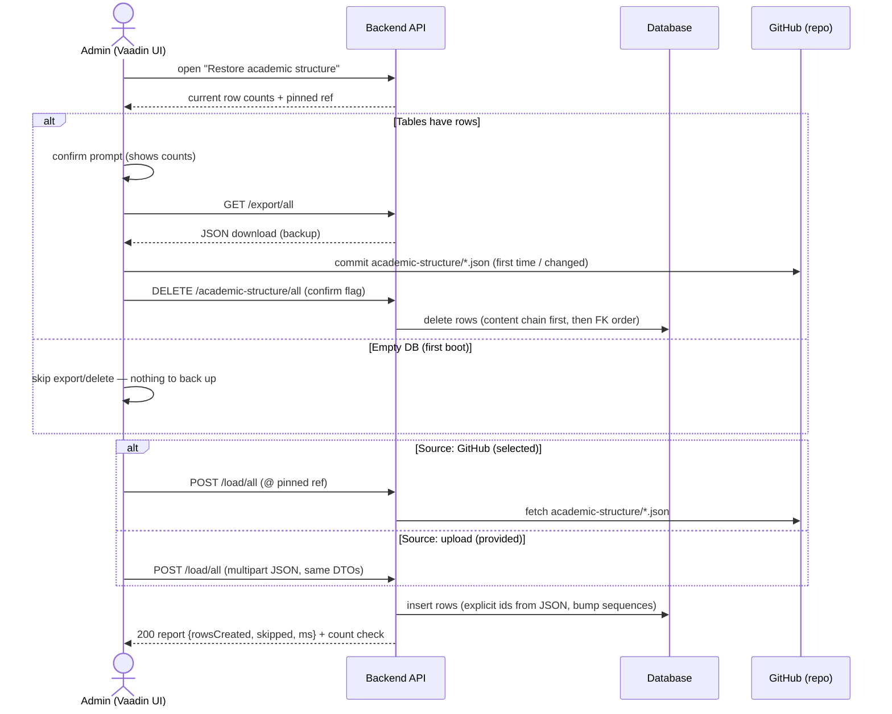

# Academic Structure Load / Export — Flows and Wireframes

> **Implemented 2026-10-19** — backend package
> `content.academicstructure` (load/export/purge/status + tests, 87 green) on
> `feat/academic-structure-offerings`; admin UI view
> `AcademicStructureRestoreView` ("Academic restore") in
> `study-shield-backend-admin`. Implementation notes vs this design: explicit-id
> inserts use **native SQL** (Hibernate IDENTITY rejects explicit ids on both
> persist and merge); upload is a **raw JSON body** on the same load endpoint,
> one entity at a time; conflict 409s name the blocking tables in the message.

Design artifacts for the `POST /load` + `GET /export` endpoints discussed in the
`my-buzz-explore` thread. Builds on the matrix introduced by
`study-shield-backend` branch `feat/academic-structure-offerings`.

**Decisions locked (2026-10-19, krushnat):**

1. **Purge = DELETE endpoint** (guarded, confirm flag) — not runbook SQL.
2. **Admin-UI-driven restore flow** (Vaadin, `study-shield-backend-admin`):
   confirm prompt → export/download current data → (first time: human commits
   the JSON to GitHub) → DELETE rows → load selected (GitHub) or provided
   (uploaded) data. See §8.
3. **Empty DB → straight load.** The export/delete steps only run when tables
   already have rows.
4. **Structure ids preserved** across export/load (export carries `id`, load
   inserts explicit ids and bumps the identity sequence) — keeps FK targets
   stable for content rows and makes `load(export(x))` exact.
5. **Question ids NOT preserved** — questions are content, reseeded from the
   question-bank code, outside this load/export scope. The feat-branch startup
   transition already wipes the content chain and leaves history tables alone
   (`sql/schema.sql:59–61`), accepting dangling history links. Question
   versioning (`version_group_id`/`version_number`/`superseded_by_id`,
   `sql/schema.sql:43–50`) lives on questions only and is unaffected by this
   feature. If attempt history must survive content rebuilds, that is a
   separate content archive/restore feature.
6. **`?publish=true` dropped from v1** (recommended; pending final OK) — the UI
   flow has the human commit the downloaded JSON, so backend GitHub write
   access is unnecessary. Trivial to re-add later.

**Purge order (updated):** content chain first (questions → quizzes →
content_packs → quiz_bundles — FKs to offerings block the offerings delete),
then structure: offerings → subjects → board-classes → boards → countries →
class-levels. Content is reseeded from the bank by the existing startup seeder.

**Entities (FK order):** `class-levels → countries → boards → board-classes → subjects → offerings`

---

## 1. Big Picture — the data loop



Two invariants keep the loop honest:

1. **Same schema, same DTOs, deterministic ordering** on both directions → `load(export(x))` round-trips, git diffs stay clean.
2. **Load ref is pinned to a tag/SHA**, never `main` → deploys are reproducible.

---

## 2. Load endpoint flow



Notes:

- **Empty-before-load guard** makes the endpoint a one-shot initializer, never a merge/sync. Re-running on seeded data just refuses (safe default).
- **`all` preflights first**, then loads one transaction per entity — a mid-sequence failure leaves clear resumable state (rerun fills only the still-empty tables).
- **No free-form URL ever accepted** — only the entity name in the path → no SSRF surface.

---

## 3. Export endpoint flow

> v1 note: `?publish=true` is **dropped from v1** (2026-10-19) — the admin-UI
> flow downloads the JSON and a human commits it, so the backend never needs
> GitHub write access. The diagram below keeps the publish branch for
> reference if it is re-added later.

```mermaid
flowchart TD
    START["GET /api/v1/academic-structure/export/{entity}<br/>entity optional (omitted = all)<br/>?publish=true? (v1: removed)"] --> AUTH{ADMIN?}
    AUTH -->|no| 403[403 Forbidden]
    AUTH -->|yes| EMPTY{Any target table empty?}
    EMPTY -->|yes| 409[409 + counts<br/>nothing returned]
    EMPTY -->|no| READ[Read DB rows in FK order]

    READ --> SER["Serialize with SAME DTOs as load<br/>deterministic sort"]
    SER --> PUB{publish=true?<br/>(not in v1)}

    PUB -->|no| BODY["200: JSON body<br/>ready to commit by hand"]
    PUB -->|yes| TOKEN{GitHub token<br/>configured?}
    TOKEN -->|no| ERR[400: publish requested<br/>but no contents:write token]
    TOKEN -->|yes| BR["Commit to branch<br/>data/academic-structure-YYYYMMDD<br/>(NEVER to the pinned ref / main)"]
    BR --> LINK["200: branch + commit SHA +<br/>PR-ready summary"]

    BODY --> END[Done]
    LINK --> END
    ERR --> END
```

- Default is **response-body JSON** — for the one-time bootstrap this is the whole point: review, commit manually.
- `?publish=true` (if ever re-added) always lands as a **branch/PR**, so a human merges canonical catalog data.
- Export carries each row's **`id`** so load can insert explicit ids and keep history FK targets stable (decision 4).

---

## 4. One-time bootstrap sequence (export → wipe → reload)

Ordered so the DB is never deleted before its replacement is validated.



**Ordering rule:** in practice the DB already has rows (they came from the old
seeder), so the practical sequence is:

```
export → commit/merge to main → pin ref to that SHA
→ purge (FK order) → POST /load/all → count check ✓  → done
```

If load fails at any point the pre-purge JSON + original DB still exist — nothing is lost until the *final* verified step.

---

## 5. Purge path — **row data only, never the DB or tables**

Clarified with krushnat 2026-10-19: there is no "database delete" concept.
Purge means deleting the **rows** of an entity so the empty-before-load guard
passes. Tables, schema, sequences, and the database itself all stay. The data
is needed — hence export first.

**Decided 2026-10-19: purge happens through a guarded DELETE endpoint**
(not runbook SQL).



Content chain is deleted **before** structure because `quizzes.offering_id`
and `content_packs.offering_id` FKs block an offerings-row delete. Content is
reseeded from the question bank by the existing startup seeder — question ids
and version chains regenerate; history links to old questions dangle (same as
the feat-branch startup transition already accepts, `sql/schema.sql:59–61`).

### Dependencies found in the code (what can block a row delete)

Real FK constraints in `sql/schema.sql`:

- `board_class.board_id` → `boards`, `board_class.class_level_id` → `class_levels` (schema.sql:175–184)
- `board_class_subject.board_class_id` → `board_class`, `.subject_id` → `subjects` (schema.sql:187–196)

JPA mappings (FKs created by Hibernate `ddl-auto:update`):

- `content_packs.subject_id` (NOT NULL, legacy — dropped by the feat-branch transition), `content_packs.offering_id` → `offerings`, `quizzes.offering_id` → `offerings`, `quizzes.content_pack_id` → `content_packs`

Consequences for the purge:

1. **Content rows that reference offerings block an offerings-row delete.** Either null `offering_id` (nullable) or purge the content chain first (`questions → quizzes → content_packs → quiz_bundles`) — which is safe: the startup transition already TRUNCATEs that chain and rebuilds it from the matrix (`CatalogStartupSeeder` / `FreemiumCatalogRebuildRunner`).
2. **No FK from history tables.** `quiz_attempts.quizId`, `quiz_results`, `question_feedback`, `child_profile` ids are plain Long columns (confirmed by the feat-branch schema comment) — purge never fails on them. But after reload the ids drift unless export carries `id` and load inserts explicit ids (then bumps the identity sequence). Decide: preserve ids (history links stay valid) or accept dangling links (same as the existing legacy wipe).
3. **Never `DROP` and never a blind `TRUNCATE … CASCADE`** — a bare CASCADE would take content/attempts tables with it. Delete the listed entity's rows explicitly, in order, one transaction each (mirrors how the feat-branch transition lists tables explicitly).

---

## 6. API surface wireframe

```
POST /api/v1/academic-structure/load/{entity}      ADMIN
    entity: class-levels | countries | boards | board-classes
            | subjects | offerings | all (or omitted = all)
    ?dryRun=true → 200 plan, no writes

GET  /api/v1/academic-structure/export/{entity}    ADMIN
    entity: same set, omitted = all
    (?publish=true — dropped from v1; human commits the downloaded JSON)

DELETE /api/v1/academic-structure/{entity}         ADMIN  ← DECIDED
    requires confirmation flag; content chain first, then reverse-FK order
```

### 200 — load report

```json
{
  "status": "ok",
  "dryRun": false,
  "ref": "a1b2c3d…",
  "entities": [
    {
      "entity": "class-levels",
      "sourceUrl": "https://raw.githubusercontent.com/…/a1b2c3d/academic-structure/class-levels.json",
      "rowsCreated": 17,
      "rowsSkipped": 0,
      "ms": 212
    },
    {
      "entity": "offerings",
      "sourceUrl": "…",
      "rowsCreated": 104,
      "rowsSkipped": 0,
      "ms": 480
    }
  ]
}
```

### 409 — non-empty guard

```json
{
  "status": "conflict",
  "message": "Target tables are not empty; load is initialize-only.",
  "conflicts": [
    { "entity": "boards", "currentRows": 7 },
    { "entity": "offerings", "currentRows": 104 }
  ]
}
```

### 409 — missing parent

```json
{
  "status": "conflict",
  "entity": "offerings",
  "missingParents": [
    { "entity": "board-classes", "ids": [12, 13] }
  ],
  "message": "Parent rows absent; load parents first (or use /load/all)."
}
```

### 200 — export (response-body default)

```json
{
  "entity": "boards",
  "rowCount": 7,
  "ref": "a1b2c3d…",
  "data": [
    { "code": "CBSE", "name": "CBSE", "minOrdinal": 1, "maxOrdinal": 17 },
    { "code": "MH",   "name": "Maharashtra", "minOrdinal": 1, "maxOrdinal": 17 }
  ]
}
```

`data[]` uses **the same element schema the load endpoint consumes**, sorted by
primary key — the round-trip invariant.

---

## 7. ASCII fallback (renders without Mermaid)

### Load (single entity)

```
POST /load/{entity}
      │
      ▼
  ADMIN? ──no──▶ 403
      │yes
      ▼
 table empty? ──no──▶ 409 + counts (nothing written)
      │yes
      ▼
 fetch JSON @ pinned ref (5s/15s timeouts, host allowlist)
      │
      ▼
 parents exist? ──no──▶ 409 naming missing parent
      │yes
      ▼
 insert rows ──▶ 200 report {sourceUrl, rowsCreated, rowsSkipped, ms}
```

### Bootstrap order

```
export(all) → commit+merge → pin ref to SHA
      → purge (reverse FK order) → POST /load/all → count check ✓
      [DB only deleted last; JSON validated before wipe]
```

---

## 8. Admin UI restore flow (Vaadin, `study-shield-backend-admin`)

Per krushnat 2026-10-19: the whole flow is driven from the admin UI with a
confirm prompt. "Provided" = uploaded JSON; "selected" = files already on
GitHub. Both paths use the **same DTOs and validation** as the API.



**First-time bootstrap specifically:** no GitHub files exist yet, so the UI
steps are: confirm → **download existing data** → prompt admin to **commit the
JSON to GitHub** → re-pin `app.academic-data.ref` to that commit (runbook step,
UI displays current ref) → delete rows → load from GitHub.

Notes:

- The UI never calls DELETE without the confirm prompt; the DELETE endpoint
  additionally requires a confirm flag (belt and braces).
- Upload ("provided") is for testing / emergency restore; GitHub remains the
  source of truth — after an upload load the admin should export and commit so
  the repo matches the DB.
- Structure ids round-trip (decision 4); question ids regenerate with the
  content reseed (decision 5) — attempt history to old questions dangles, same
  as the existing feat-branch transition accepts.
